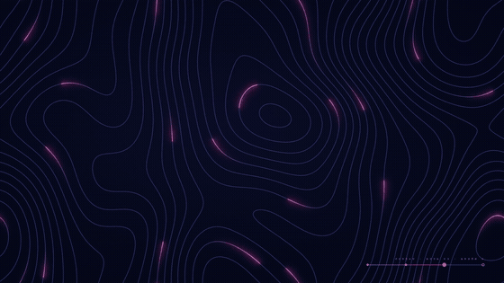
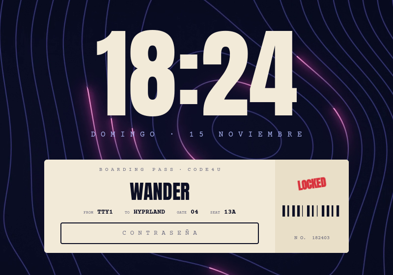
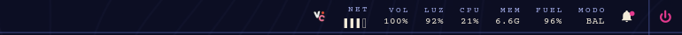

# CODE4U · dots

> Arch + Hyprland con estética de terminal de autobuses nocturna: mapa topográfico animado, neón rosa, boletos crema y tipografía de tablero de salidas.



| Lock screen | Barra |
|---|---|
|  |  |

## Qué trae

| Pieza | Programa | Dónde |
|---|---|---|
| WM | Hyprland (config en **Lua**) | `config/hypr/hyprland.lua` |
| Fondo animado | mpvpaper + loop renderizado con numpy | `config/code4u/wall/` |
| Lock | hyprlock: "boarding pass" | `config/hypr/hyprlock.conf` |
| Login | greetd + tuigreet | `system/greetd/config.toml` |
| Barra | waybar (paradas de la ruta) | `config/waybar/` |
| Notificaciones | swaync: avisos tipo boleto | `config/swaync/` |
| Terminal | kitty + zsh + starship | `config/kitty/`, `home/.zshrc`, `config/starship.toml` |
| Multiplexor | zellij + zjstatus | `config/zellij/` |
| Launcher | rofi / fuzzel | `config/rofi/`, `config/fuzzel/` |
| Editor | Neovim (LazyVim) | `config/nvim/` |
| Discord | Vencord (Vesktop) quickCss | `config/vesktop/settings/quickCss.css` |
| Apps GTK / Qt | adw-gtk3-dark + colores CODE4U · qt6ct Fusion | `config/gtk-*/`, `config/qt6ct/` |
| Extras | sonidos, OSD de volumen/brillo, capturas, portapapeles | `config/code4u/` |

### Paleta

| | | | | |
|---|---|---|---|---|
| `#0d0f24` noche | `#1b1f4a` andén | `#6b79d6` ruta | `#e33a8e` neón | `#f2ead8` boleto |

Fuentes: **Anton** (títulos), **MartianMono Nerd Font** (texto, código e íconos), **Courier Prime** (detalles de boleto).

## Instalar

```bash
git clone https://github.com/WanderTheWeeb/dotfiles ~/dotfiles
cd ~/dotfiles
./install.sh --all      # paquetes + configs + greetd/servicios
```

- `./install.sh` solo enlaza configs (symlinks al repo), fuentes, el plugin de zellij y el tema GTK.
- `--packages` instala `packages/pacman.txt` y `packages/aur.txt` con `yay`.
- `--system` copia el login de greetd, prende servicios (docker, fstrim, paccache, power-profiles) y pone el teclado **latam**.
- Lo que ya tengas se respalda como `*.pre-code4u-<fecha>`.

Como todo queda enlazado, lo que edites en `~/.config` ya está en el repo: `git add -A && git commit`.

## Atajos

| Tecla | Acción |
|---|---|
| `SUPER + T` / `SUPER + RETURN` | terminal |
| `SUPER + SHIFT + RETURN` | terminal con zellij (sesión `code4u`) |
| `SUPER + Q` | cerrar ventana |
| `SUPER` (soltar) | navegador de archivos (rofi) |
| `SUPER + SHIFT + M` | sonidos on/off |
| `Alt + 1..4` | parada (tab) de zellij |
| `Alt + h` / `Alt + l` | tab anterior / siguiente |
| `Alt + n` | pane a la derecha |
| `Alt + \|` | pane abajo (tecla a la izquierda del 1 en teclado latino) |

## Fondo animado

`config/code4u/wall/render.py` genera un loop perfecto de 12 s (curvas que se mecen + cometas de neón).
Cambia `K` (densidad), `AMP` (cuánto se mecen) o `lit` (cuántas curvas llevan neón) y vuelve a renderizar:

```bash
cd ~/.config/code4u/wall
uv run --with numpy --with pillow python render.py ~/.config/hypr/wall/code4u-loop.mp4
~/.config/code4u/wall/start          # recarga el fondo
~/.config/code4u/wall/start static   # fondo fijo (ahorra batería)
```

Con `intel-media-driver` (VA-API) consume ~6 % de un núcleo.
